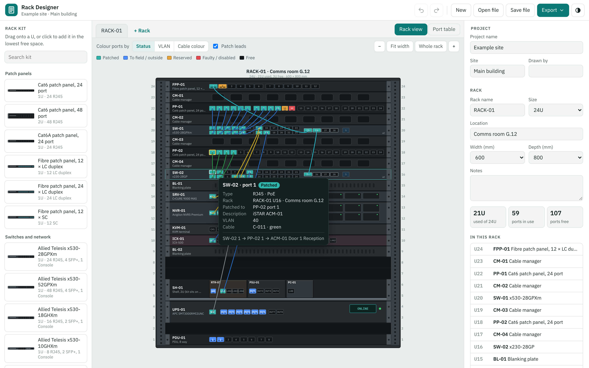
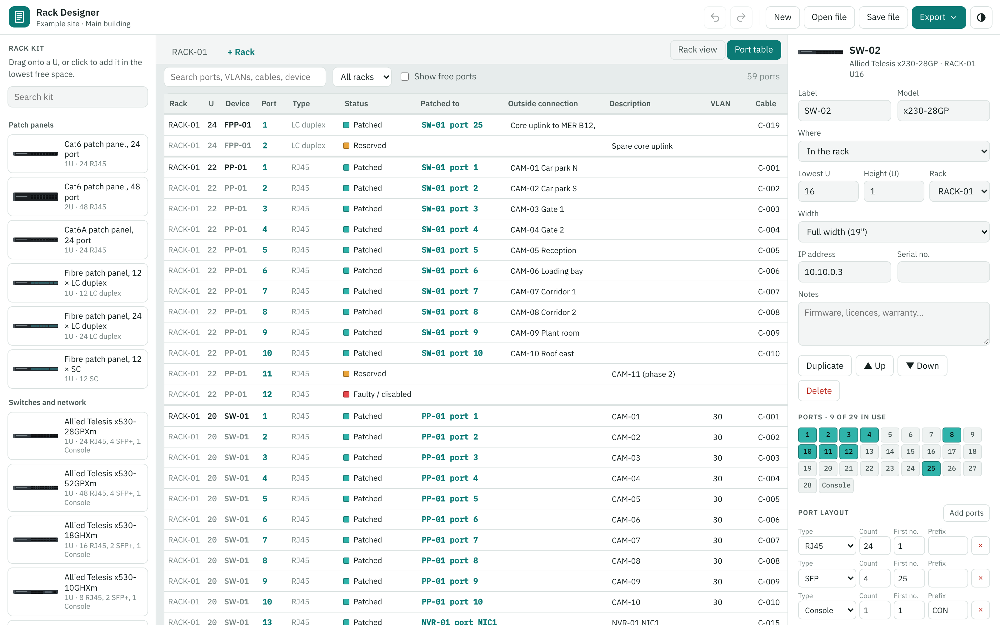
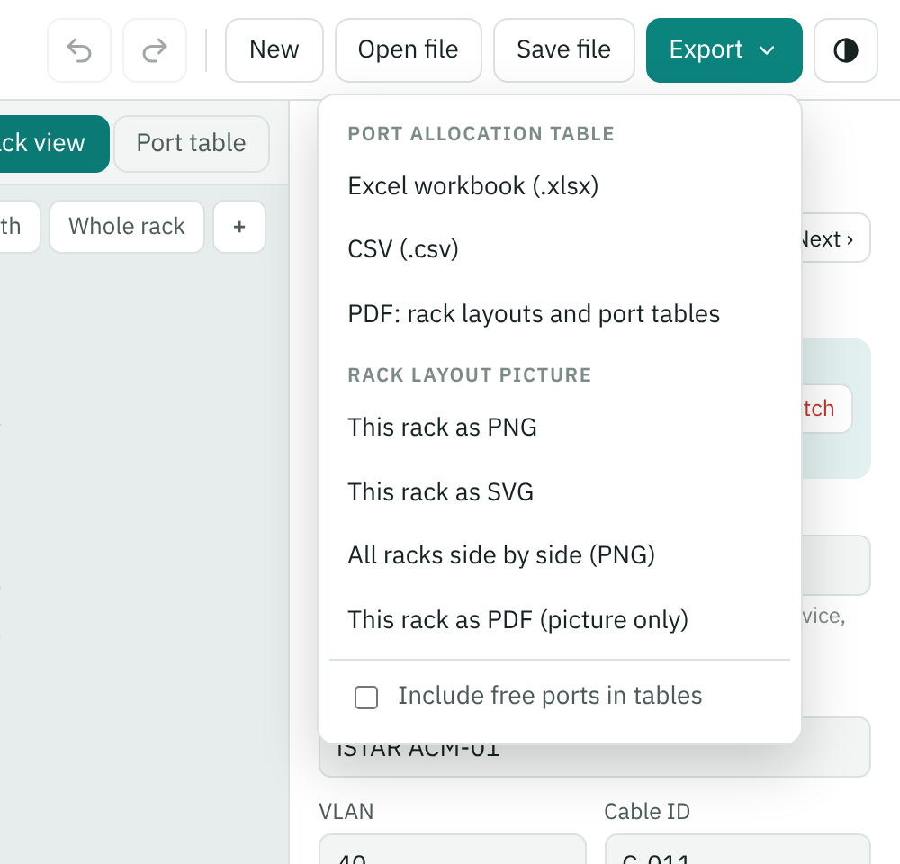
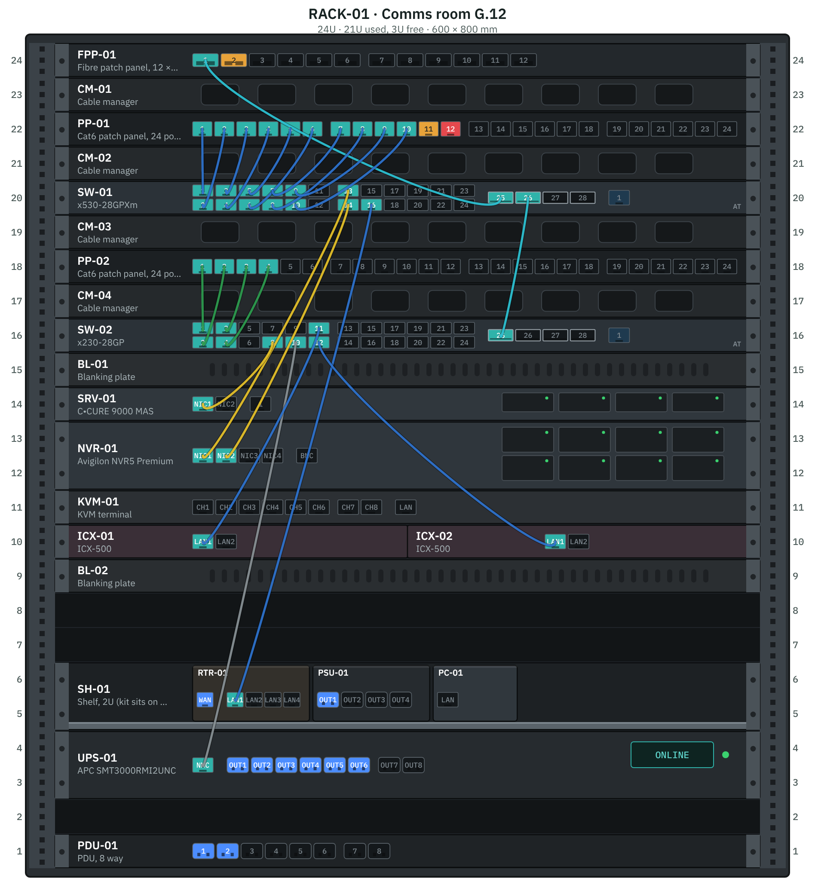
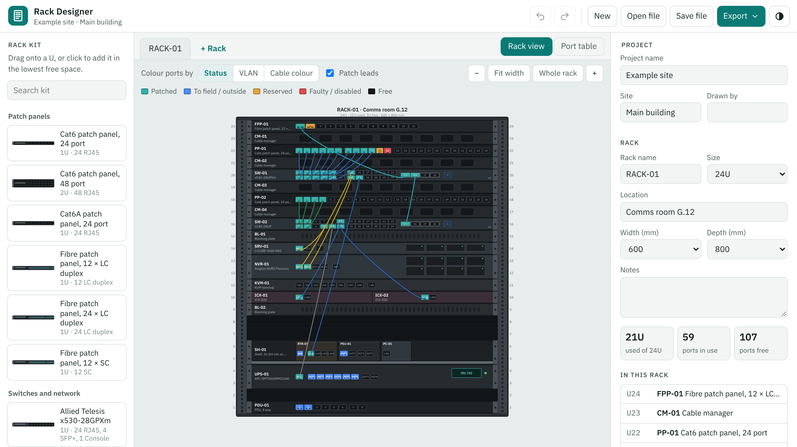
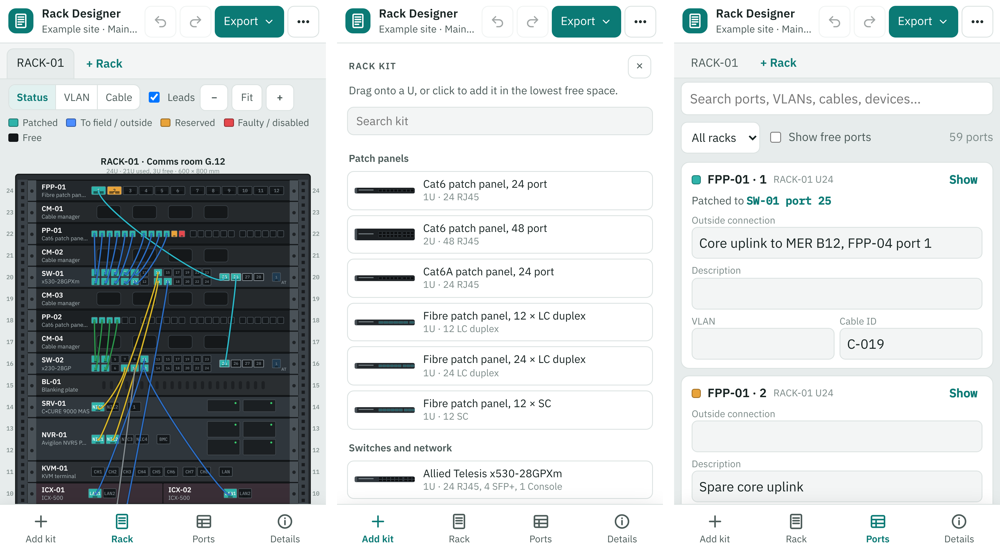
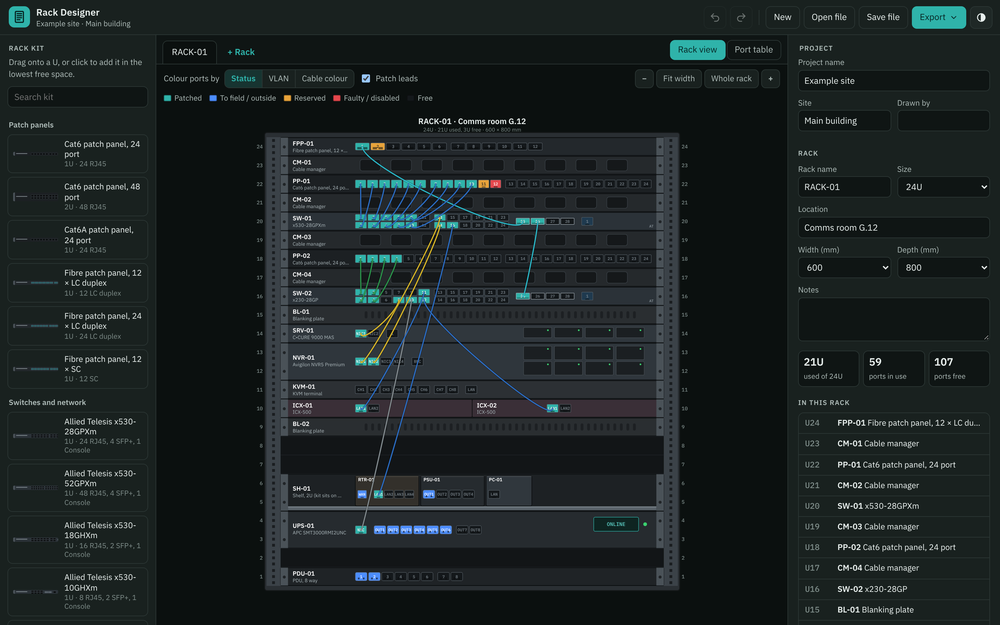

# Rack Designer

Design comms and server racks visually, allocate every switch, patch panel and device port, and export the port allocation table and a picture of the rack.

Rack Designer is **one HTML file** that runs in any modern browser. There is nothing to install, no server and no account, and it works fully offline: the page's security policy blocks all network access, so nothing you draw ever leaves your computer.


## Contents

- [Getting started](#getting-started)
- [Features](#features)
  - [Drawing a rack](#drawing-a-rack)
  - [Allocating ports](#allocating-ports)
  - [Hover pop-ups](#hover-pop-ups)
  - [Colouring ports](#colouring-ports)
  - [The port table](#the-port-table)
  - [Exports](#exports)
  - [Saving your work](#saving-your-work)
  - [Laptops, tablets and phones](#laptops-tablets-and-phones)
  - [Light and dark](#light-and-dark)
- [Kit library](#kit-library)
- [Keyboard shortcuts](#keyboard-shortcuts)
- [Building from source](#building-from-source)
- [Repository layout](#repository-layout)
- [Third-party licences](#third-party-licences)

## Getting started

1. Download [`dist/system-draw-rack-designer.html`](dist/system-draw-rack-designer.html) (on GitHub, open the file and press **Download raw file**).
2. Double-click it to open it in Chrome, Edge, Firefox or Safari.
3. The first time it opens you get an example project, a 24U comms rack with patch panels, switches, servers, a shelf of desktop kit and a UPS, so you can see how everything fits together. Press **New** and type `1` for an empty 42U rack, or `2` to get the example back.

That's it. Your work is kept in the browser as you go, and **Save file** writes it to a `.rack.json` file you can keep, email or open on another machine.

## Features

### Drawing a rack

- **Add kit** from the library on the left: drag an item onto a U position, or click it to drop it into the lowest free space that fits.
- **Move** kit by dragging it, with the **▲ Up / ▼ Down** buttons, or with the arrow keys. The app stops you overlapping kit and flags anything that does not fit.
- **Half-width kit** such as Zenitel ICX units sits side by side in the same U (left half and right half).
- **Shelves** (1U, 2U and 3U) carry desktop kit such as NVRs, small switches, routers, mini PCs, power supplies and media converters. Kit on a shelf slides left and right along it, and the shelf shows how much of its width is used.
- **Several racks** per project: add one with **+ Rack**, switch between them with the tabs, and duplicate or delete a rack from its details. Each rack has a name, location, height (U), width and depth.
- Every device gets an automatic label (`PP-01`, `SW-02`, `NVR-01`…) that you can change, plus model, IP address, serial number, colour and notes.
- The right-hand panel shows the rack's U used and free, ports in use and free, and a list of everything in the rack from top to bottom.
- **Undo and redo** for every change (up to 80 steps).

### Allocating ports

Click any port to open its details on the right.


For each port you can record:

| Field | What it is for |
| --- | --- |
| **Connects to** | Patch it to a port on any other device, in this rack or another. Choose the device and port from the lists, or press **Pick on the rack** and click the other end. **Go to** jumps to the far end, **Unpatch** removes the lead. |
| **Outside connection** | Where the port goes beyond the racks: a camera, door controller, floor outlet or another room (for example `CAM-01 Car park, outlet 2.14`). |
| **Description** | What the port is for. |
| **VLAN** | The VLAN number or name. |
| **Cable ID** | The cable label. New patch leads are numbered automatically (`C-001`, `C-002`…). |
| **Cable colour** | Blue, yellow, green, red, grey, white, black, orange, purple, pink, aqua, OS2 yellow or OM4 violet. |
| **Speed** | 100M up to 40G. |
| **PoE powered** | For switch ports. |
| **Reserved** / **Faulty / disabled** | Marks the port so nobody uses it. |
| **Notes** | Anything else. |

**‹ Prev** and **Next ›** (or the left and right arrow keys) step through the device's ports so you can fill in a whole panel quickly.

To save time on big jobs, a device's details have a **Patch ports** box that patches a run of ports straight across, for example patch panel ports 1–24 to switch ports 1–24, with an optional VLAN. You can also **Add ports** to any device (choosing type, count, prefix and first number) to match the real hardware.

Patch leads are drawn on the rack as coloured curves between the two ports. Turn them off with the **Patch leads** tick box when you only want to see the faces.

### Hover pop-ups

Hover over any port to see everything about it without clicking: its type and speed, PoE, rack position, what it is patched to, the outside connection, description, VLAN, cable ID and colour, and notes. The last line traces the path, so you can follow a cable from the switch through the patch panel to the field device:

`SW-02 1 → PP-02 1 → ACM-01 Door 1 Reception`



Hovering over a device shows its kit type, model, position, IP address, serial number, how many ports are in use and, for a shelf, what sits on it.

### Colouring ports

**Colour ports by** changes what the port colours mean:

- **Status**: patched (teal), to field / outside (blue), reserved (amber), faulty / disabled (red) and free (dark).
- **VLAN**: each VLAN gets its own colour, with a legend of the VLANs in use.
- **Cable colour**: each port shows the colour of the lead plugged into it.


### The port table

**Port table** lists every allocated port in the project in one place: rack, U, device, port, type, status, patched to, outside connection, description, VLAN, cable ID, cable colour, speed, PoE and notes. You can search it (by port, VLAN, cable, device, anything), filter to one rack, show free ports too, and edit fields straight in the table. Click a port's name to jump to it on the rack.



### Exports

Everything is under the **Export** button.



**Port allocation table**

| Export | What you get |
| --- | --- |
| **Excel workbook (.xlsx)** | Three sheets: *Port allocation* (every port, all 16 columns), *Cable schedule* (one row per patch lead: cable ID, both ends, type, colour, VLAN) and *Rack layout* (every device with U, height, label, kit, model, IP, serial and ports used). |
| **CSV (.csv)** | The port allocation table, ready for any spreadsheet or import. |
| **PDF: rack layouts and port tables** | A landscape A3 report: each rack drawn next to its device list, then the full port allocation table, then the cable schedule. |

Tick **Include free ports in tables** to list unused ports as well.

**Rack layout picture**

| Export | What you get |
| --- | --- |
| **This rack as PNG** | A high-resolution picture of the current rack with all ports and patch leads. |
| **This rack as SVG** | The same as a vector drawing, for CAD, Visio or documents. |
| **All racks side by side (PNG)** | Every rack in the project in one picture. |
| **This rack as PDF (picture only)** | Just the rack drawing on a page. |

Examples of every export made from the built-in example project are in [`examples/`](examples/).

<p align="center"></p>


### Saving your work

- Your project is **saved in the browser automatically** after every change, so closing the tab does not lose anything on that computer.
- **Save file** (Ctrl+S) writes a `.rack.json` file. In Chrome and Edge you choose where it goes; other browsers put it in Downloads.
- **Open file** loads a `.rack.json` file back in.
- The project name, site and "drawn by" are set in the panel on the right and appear on every export.

### Laptops, tablets and phones

The layout adapts to the screen. On a 1366 × 768 laptop the kit library and details panel narrow and **Fit width** / **Whole rack** zoom the drawing to suit.



On a phone, tabs along the bottom switch between **Add kit** (a drawer of kit), **Rack**, **Ports** (the port table as editable cards) and **Details** (a sheet that slides up), so you can check or update allocations standing in front of the rack.



### Light and dark

The half-moon button switches between light and dark. It follows your system setting until you choose, then remembers your choice.



## Kit library

| Group | Kit |
| --- | --- |
| **Patch panels** | Cat6 24 port (1U), Cat6 48 port (2U), Cat6A 24 port, fibre 12 × LC duplex, fibre 24 × LC duplex, fibre 12 × SC |
| **Switches and network** | Allied Telesis x530-28GPXm, x530-52GPXm, x530-18GHXm, x530-10GHXm, x230-28GP, x230-18GP, x230-10GP; generic 24 + 4 SFP and 48 + 4 SFP switches; router / firewall; media converter chassis |
| **Servers and recorders** | C•CURE 9000 server, Avigilon NVR server, NVR / recorder, 1U and 2U servers (with iDRAC), Zenitel ICX unit (half width), KVM terminal |
| **Power** | UPS 2U and 3U (each with a network card port and 8 outlets), PDU 8 way |
| **Accessories and shelves** | Cable manager, brush plate, blanking plate, shelves (1U, 2U, 3U), fan tray |
| **Shelf kit** (sits on a shelf) | Desktop NVR with 8 PoE, desktop 8 port switch, router / modem, mini PC / workstation, power supply, media converter, small device |
| **Custom** | A custom device with whatever ports you give it |

Port types are RJ45, SFP, SFP+, LC duplex, SC, console and power outlet. Ports are numbered the way the real kit is (switches zig-zag top/bottom, panels run left to right) and can have prefixes such as `NIC`, `LAN`, `OUT` or `CH`.

Search the library with the box at the top.

## Keyboard shortcuts

| Keys | Action |
| --- | --- |
| Ctrl+Z / Cmd+Z | Undo |
| Ctrl+Y, Ctrl+Shift+Z | Redo |
| Ctrl+S / Cmd+S | Save file |
| ↑ / ↓ | Move the selected device up or down 1U |
| ← / → | With a port selected: previous / next port. With shelf kit selected: slide it along the shelf |
| Delete / Backspace | Delete the selected device (Ctrl+Z brings it back) |
| Esc | Cancel picking, then clear the port, then the device selection |

## Building from source

The app is written as plain HTML, CSS and JavaScript in `src/`, with no framework and no npm packages. `build.py` puts it all into the single offline file, inlining jsPDF and the IBM Plex fonts from `vendor/`.

```sh
python3 -I build.py
# built dist/system-draw-rack-designer.html 580894 bytes
```

Python 3.8 or newer is all you need. GitHub Actions runs the build on every push to `main`, checks that the committed `dist/` file matches the source, and uploads the built page as a downloadable artifact.

To work on it, edit the files in `src/`, run the build and open `dist/system-draw-rack-designer.html` in a browser.

## Repository layout

```
.
├── build.py                       builds dist/ from src/ and vendor/
├── src/
│   ├── index.html                 page shell with build placeholders
│   ├── app.css                    styles, light and dark themes, laptop and phone layouts
│   └── app.js                     the app: kit catalogue, drawing, ports, table, exports
├── vendor/                        jsPDF and IBM Plex fonts (with their licences)
├── dist/
│   └── system-draw-rack-designer.html   the built app: this is the file to use
├── examples/                      exports made from the built-in example project
└── docs/screenshots/              the pictures in this README
```

## Third-party licences

- [jsPDF](https://github.com/parallax/jsPDF), MIT licence: [`vendor/LICENSE-jsPDF.txt`](vendor/LICENSE-jsPDF.txt)
- [IBM Plex](https://github.com/IBM/plex) fonts, SIL Open Font Licence 1.1: [`vendor/LICENSE-IBM-Plex-OFL.txt`](vendor/LICENSE-IBM-Plex-OFL.txt)

Rack Designer is part of the System Draw family of tools.
