# Rack Designer

Design comms and server racks visually, allocate every switch, patch panel and device port, and export the port allocation table and a picture of the rack.

Rack Designer is **one HTML file** that runs in any modern browser. There is nothing to install, no server and no account, and it works fully offline: the page's security policy blocks all network access, so nothing you draw ever leaves your computer.

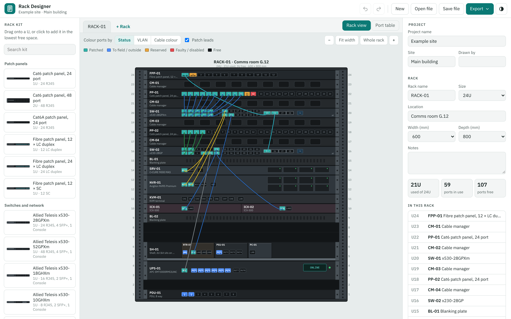

## At a glance

- **Draw racks to scale**: drag kit into place by the U, with half-width units, shelves of desktop kit, and several racks per project.
- **Real-looking kit**: Allied Telesis x530 and x230 switches, Zenitel ICX units, Avigilon NVR5 recorders and rack UPSs are drawn like their real front panels, with green link lights on patched ports.
- **Front and back**: turn the rack round to see the ports, power inlets and 0U PDUs on the back.
- **Every port allocated**: patch leads, outside connections, VLANs, cable IDs and colours, speed, PoE, reserved and faulty ports.
- **Power**: choose the UPS or PDU outlet that feeds each power supply, and get a power schedule.
- **C•CURE IP-ACM drawer**: a 2U pull-out drawer with six labelled IP-ACM door modules, shown open or shut.
- **Asset codes with QR codes**: type in each device's asset code and its QR code shows when the device is selected; print a sheet of asset labels.
- **Recorder drives**: choose the hard drive size in every NVR bay and see the total storage.
- **Hover pop-ups** that trace a cable from the switch, through the patch panel, to the field device.
- **Exports**: Excel, CSV and PDF port and power schedules, plus PNG, SVG and PDF pictures of the rack, front and back.
- **Works anywhere**: desktop, laptop or phone, light or dark, fully offline.

## Contents

- [At a glance](#at-a-glance)
- [Getting started](#getting-started)
- [Features](#features)
  - [Drawing a rack](#drawing-a-rack)
  - [Front and back](#front-and-back)
  - [Power: UPS, PDUs and 0U PDUs](#power-ups-pdus-and-0u-pdus)
  - [C•CURE IP-ACM drawer](#ccure-ip-acm-drawer)
  - [Asset codes and QR codes](#asset-codes-and-qr-codes)
  - [NVR drives](#nvr-drives)
  - [Allocating ports](#allocating-ports)
  - [Hover pop-ups](#hover-pop-ups)
  - [Colouring ports](#colouring-ports)
  - [The port table](#the-port-table)
  - [Exports](#exports)
  - [Saving your work](#saving-your-work)
  - [Laptops, tablets and phones](#laptops-tablets-and-phones)
  - [Light and dark](#light-and-dark)
- [Kit library](#kit-library)
  - [Real-looking faceplates](#real-looking-faceplates)
  - [Changing a model](#changing-a-model)
- [Keyboard shortcuts](#keyboard-shortcuts)
- [Building from source](#building-from-source)
- [Repository layout](#repository-layout)
- [Third-party licences](#third-party-licences)

## Getting started

1. Download [`dist/system-draw-rack-designer.html`](dist/system-draw-rack-designer.html) (on GitHub, open the file and press **Download raw file**).
2. Double-click it to open it in Chrome, Edge, Firefox or Safari.
3. The first time it opens you get an example project: a 24U comms rack with patch panels, Allied Telesis x530 and x230 switches, a C•CURE server, an Avigilon NVR5, two Zenitel ICX units, an IP-ACM drawer, a shelf of desktop kit, a UPS, a PDU and two 0U PDUs at the back, all patched and powered, so you can see how everything fits together. Press **New** and type `1` for an empty 42U rack, or `2` to get the example back.

That's it. Your work is kept in the browser as you go, and **Save file** writes it to a `.rack.json` file you can keep, email or open on another machine.

## Features

### Drawing a rack

- **Add kit** from the library on the left: drag an item onto a U position, or click it to drop it into the lowest free space that fits.
- **Move** kit by dragging it, with the **▲ Up / ▼ Down** buttons, or with the arrow keys. The app stops you overlapping kit and flags anything that does not fit.
- **Half-width kit** such as Zenitel ICX units sits side by side in the same U (left half and right half). Drag one sideways to swap sides.
- **Shelves** (1U, 2U and 3U) carry desktop kit such as NVRs, small switches, routers, mini PCs, power supplies and media converters. Kit on a shelf slides left and right along it, and the shelf shows how much of its width is used.
- **Several racks** per project: add one with **+ Rack**, switch between them with the tabs, and duplicate or delete a rack from its details. Each rack has a name, location, height (U), width and depth.
- Every device gets an automatic label (`PP-01`, `SW-02`, `NVR-01`…) that you can change, plus model, IP address, serial number, colour and notes.
- The right-hand panel shows the rack's U used and free, ports in use and free, and a list of everything in the rack from top to bottom.
- **Undo and redo** for every change (up to 80 steps).

### Front and back

The **Front / Back** switch above the rack turns it round. The back view is drawn as you'd see it standing behind the cabinet, so left and right swap: a half-width unit on the left at the front is on the right at the back, and kit on a shelf runs the other way.

- Ports that are on the back of the real kit are only on the back view: server and NVR network and iDRAC ports, the Zenitel ICX Ethernet and console ports, UPS outlets and network card, KVM ports, and every power inlet.
- Patch leads are drawn on the view that shows both ends. Picking a port from the port table, a patch link or the panel turns the rack round if it's on the other side.
- Designs saved before the back view existed are moved across when they're opened: catalogue kit gets its back ports put on the back.

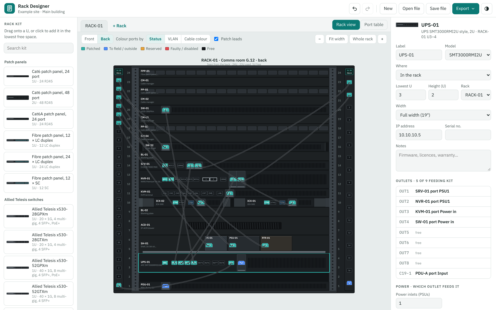

The back view on its own, as it appears in the picture exports, with the two 0U PDUs hanging at the sides:

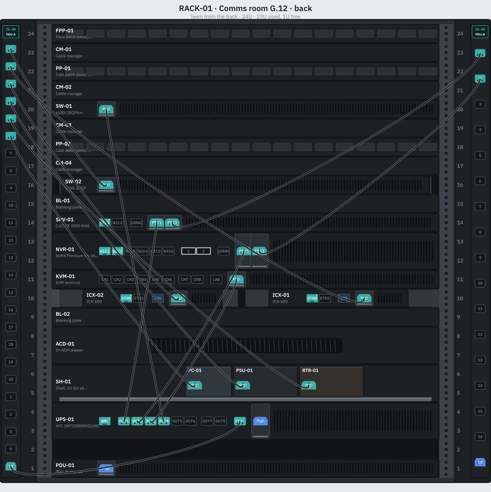

### Power: UPS, PDUs and 0U PDUs

- Every powered device has **power inlets** on the back (one or two PSUs, set in its details, up to four). Servers and Avigilon Premium recorders have two.
- The **Power** section of a device's details has a box for each inlet: choose the UPS or PDU outlet that feeds it. Outlets already feeding something say what. The power lead is drawn on the back view and the cable schedule lists it.
- A UPS or PDU shows an **Outlets** list: what each outlet feeds. Click one to edit it. A PDU's own input can be fed from a UPS outlet.
- **Vertical 0U PDUs** (16 way, or 20 × C13 + 4 × C19) hang at the back, at the sides of the cabinet. Two fit on each side, top and bottom. Adding one turns the rack to the back view. Set the side in its details; Up and Down swap the two on a side.
- The Excel workbook has a **Power** sheet and the PDF a **Power schedule** page: every inlet and the outlet that feeds it.

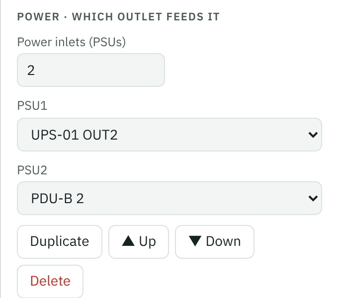

### C•CURE IP-ACM drawer

The **IP-ACM pull-out drawer** is 2U and holds six Software House IP-ACM v2 door modules.

- Click an empty slot on the drawer front (**+ IP-ACM**), or add an IP-ACM from the list: it goes in the selected drawer, or the first with a free slot, or a new drawer if there isn't one.
- Each IP-ACM has its two Ethernet ports (ETH1 with PoE, ETH2), an IP address, serial number and notes, and can be patched like any other kit.
- **Labelling**: each board has a window on the drawer front showing its slot number, label and label text (e.g. the door it controls). Set them in the drawer's details, where all six slots are listed with their label and label text, or in the IP-ACM's own details. Use a new line, or ` / ` in the drawer list, to start a new line on the label.
- **Show it open** draws the drawer pulled out with the boards showing; **Show it shut** goes back to the label windows.
- Move a board to another slot from its **Slot** box, or with Left / Right. The label text is in the *Rack layout* sheet.

I couldn't find a Software House part number for a six-board 2U drawer, so it's drawn as a plain drawer with label windows.

Shut, the drawer front shows a label window for each slot:

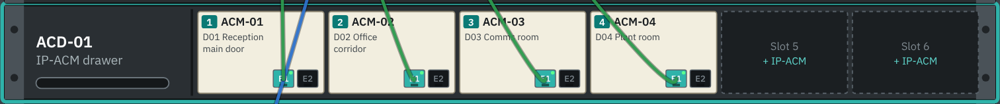

Open, the boards themselves show, with their Ethernet ports and link lights:

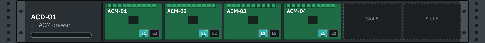

### Asset codes and QR codes

- Every device has an **Asset code** box in its details. Type in your own code; nothing is made up for you.
- When a device with an asset code is selected, its **QR code** shows under the box with the code, label and model. **Save QR as PNG** saves it as a picture for a label printer.
- If two devices have the same code (capitals ignored), both say so.
- Duplicating a device or a rack leaves the asset code blank on the copy.
- **Export › Asset labels with QR codes** makes an A4 PDF of labels, 21 to a sheet (63.5 × 38.1 mm), each with the QR code, asset code, device label, model and where it is.
- The asset code shows in the hover pop-up, the *Rack layout* sheet and the PDF device lists.
- The QR codes are made inside the app, so this works offline too.

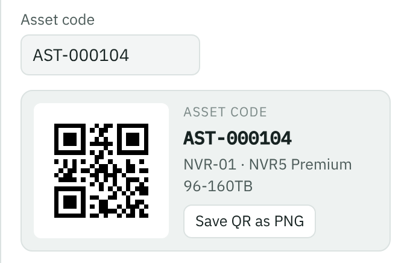

### NVR drives

- Recorders (Avigilon NVR5 models, the 2U NVR server, NVR / recorder and the desktop NVR) have a **Drives** section: choose the drive size in each bay (1 TB to 24 TB, or empty), or fill every bay at once.
- The number of bays starts at the model's (e.g. 12 on an NVR5 Premium 96-160 TB) and can be changed.
- The total raw storage shows in the section heading, the hover pop-up and the exports, e.g. *1 × 16TB + 11 × 8TB = 104 TB raw*.
- The drive sizes are drawn on the bays on the front of the recorder. Empty bays are drawn dark.

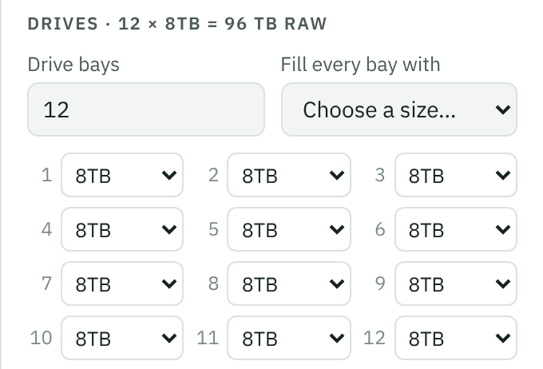

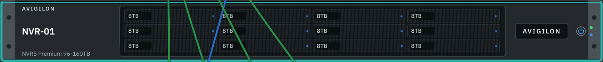

### Allocating ports

Click any port to open its details on the right.


For each port you can record:

| Field | What it is for |
| --- | --- |
| **Connects to** | Patch it to a port on any other device, in this rack or another. Press **Click the other port on the rack**: the ports it can patch to light up and the rest fade out (power outlets only go to power inlets, data ports only to data ports). Or **choose it** from the lists: devices are grouped by rack with their U, and the ports list puts free ports first and says what the others are patched to. Choosing the port patches it straight away. Once patched, **Go to** jumps to the far end, **Change** picks a new far end and **Unpatch** removes the lead. |
| **Outside connection** | Where the port goes beyond the racks: a camera, door controller, floor outlet or another room (for example `CAM-01 Car park, outlet 2.14`). |
| **Description** | What the port is for. |
| **VLAN** | The VLAN number or name. |
| **Cable ID** | The cable label. New patch leads are numbered automatically (`C-001`, `C-002`…). |
| **Cable colour** | Blue, yellow, green, red, grey, white, black, orange, purple, pink, aqua, OS2 yellow or OM4 violet. |
| **Speed** | 100M up to 40G. |
| **PoE powered** | For switch ports. |
| **Reserved** / **Faulty / disabled** | Marks the port so nobody uses it. |
| **Notes** | Anything else. |

**‹ Prev** and **Next ›** (or the left and right arrow keys) step through the device's ports so you can fill in a whole panel quickly.

You can also **Add ports** to any device (choosing type, count, prefix and first number) to match the real hardware.

Patch leads are drawn on the rack between the two ports. On the front, leads are dressed through the nearest cable manager or brush plate between the two ends: they drop into it, run along behind the rings or bristles, and come out to the other port, so the managers look in use. Leads with no manager near them hang in a curve. When other kit sits between the two ends, the lead doesn't cross its front: each end drops into the manager or brush plate next to it, goes out of sight before the manager's label, and runs up or down the side of the rack to the other end. That hidden run is shown as a faint dashed line on the rail, so you can still follow it. Turn the leads off with the **Patch leads** tick box when you only want to see the faces.

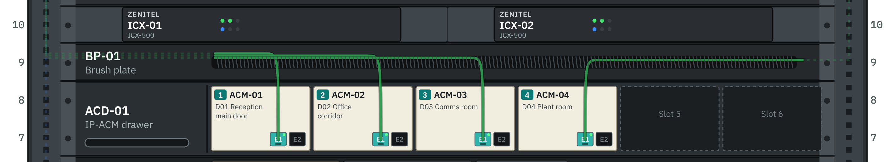

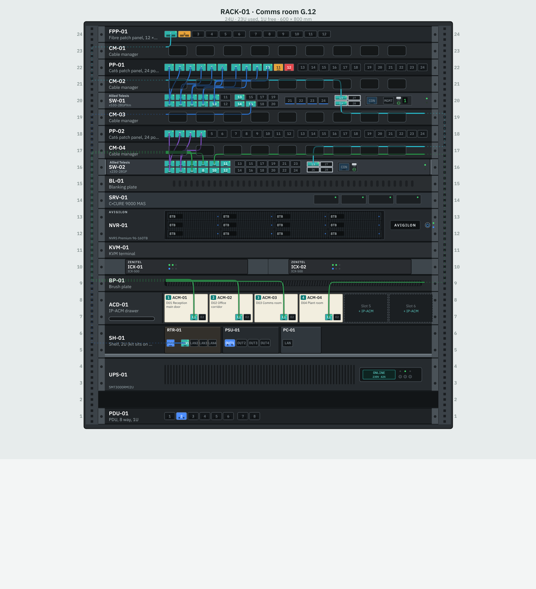

### Hover pop-ups

Hover over any port to see everything about it without clicking: its type and speed, PoE, rack position, what it is patched to, the outside connection, description, VLAN, cable ID and colour, and notes. The last line traces the path, so you can follow a cable from the switch through the patch panel to the field device:

`SW-02 1 → PP-02 1 → ACM-01 Door 1 Reception`


Hovering over a device shows its kit type, model, position, IP address, serial number, how many ports are in use and, for a shelf, what sits on it.

### Colouring ports

**Colour ports by** changes what the port colours mean:

- **Status**: patched (teal), to field / outside (blue), reserved (amber), faulty / disabled (red) and free (dark).
- **VLAN**: each VLAN gets its own colour, with a legend of the VLANs in use.
- **Cable colour**: each port shows the colour of the lead plugged into it.

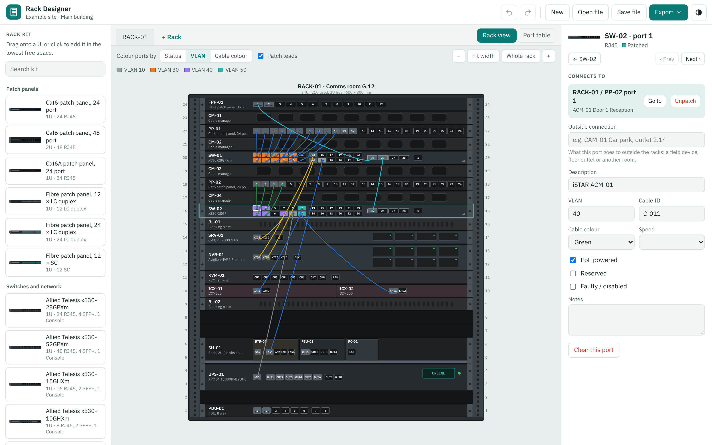

### The port table

**Port table** lists every allocated port in the project in one place: rack, U, device, port, type, status, patched to, outside connection, description, VLAN, cable ID, cable colour, speed, PoE and notes. You can search it (by port, VLAN, cable, device, anything), filter to one rack, show free ports too, and edit fields straight in the table. Click a port's name to jump to it on the rack.


### Exports

Everything is under the **Export** button.


**Port allocation table**

| Export | What you get |
| --- | --- |
| **Excel workbook (.xlsx)** | Four sheets: *Port allocation* (every port, all 16 columns), *Cable schedule* (one row per patch lead: cable ID, both ends, type, colour, VLAN), *Rack layout* (every device with U, height, label, asset code, label text, kit, model, drives, IP, serial and ports used) and *Power* (every power inlet and the outlet feeding it). |
| **CSV (.csv)** | The port allocation table, ready for any spreadsheet or import. |
| **PDF: rack layouts and port tables** | A landscape A3 report: each rack drawn front and back next to its device list, then the full port allocation table, the power schedule and the cable schedule. |

Tick **Include free ports in tables** to list unused ports as well.

**Asset labels**

| Export | What you get |
| --- | --- |
| **Asset labels with QR codes (PDF, A4)** | A sheet of 63.5 × 38.1 mm labels, one per device with an asset code: QR code, asset code, label, model and rack position. |

**Rack layout picture**

| Export | What you get |
| --- | --- |
| **This rack as PNG** | A high-resolution picture of the side of the rack showing, with all ports and patch leads. |
| **This rack, front and back (PNG)** | Front and back side by side. |
| **This rack as SVG** | The side showing as a vector drawing, for CAD, Visio or documents. |
| **All racks side by side (PNG)** | Every rack in the project in one picture. |
| **This rack, front and back (PDF)** | Just the rack drawings on an A3 page. |

Exports made from the built-in example project are in [`examples/`](examples/):

- [`example-port-allocation.xlsx`](examples/example-port-allocation.xlsx): the Excel workbook, with its Port allocation, Cable schedule, Rack layout and Power sheets
- [`example-port-allocation.csv`](examples/example-port-allocation.csv): the CSV port table
- [`example-rack-design.pdf`](examples/example-rack-design.pdf): the full PDF report
- [`example-asset-labels.pdf`](examples/example-asset-labels.pdf): the asset label sheet
- [`example-rack-01.png`](examples/example-rack-01.png) and [`example-rack-01-front-and-back.png`](examples/example-rack-01-front-and-back.png): rack pictures

**This rack, front and back (PNG)** from the example project:


Three pages of the PDF report: the rack front and back with its device list, the port allocation table, and the power schedule:

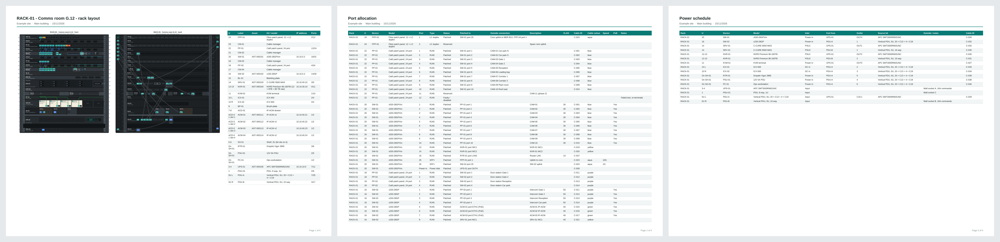

### Saving your work

- Your project is **saved in the browser automatically** after every change, so closing the tab does not lose anything on that computer.
- **Save file** (Ctrl+S) writes a `.rack.json` file. In Chrome and Edge you choose where it goes; other browsers put it in Downloads.
- **Open file** loads a `.rack.json` file back in.
- The project name, site and "drawn by" are set in the panel on the right and appear on every export.

### Laptops, tablets and phones

The layout adapts to the screen. On a 1366 × 768 laptop the kit library and details panel narrow and **Fit width** / **Whole rack** zoom the drawing to suit.


On a phone, tabs along the bottom switch between **Add kit** (a drawer of kit), **Rack**, **Ports** (the port table as editable cards) and **Details** (a sheet that slides up), so you can check or update allocations standing in front of the rack.


### Light and dark

The half-moon button switches between light and dark. It follows your system setting until you choose, then remembers your choice.


## Kit library

### Real-looking faceplates

Allied Telesis switches and Zenitel ICX units are drawn like their real front panels, so the rack picture looks like the cabinet on site:

- **x530**: 1G copper ports, then the multi-gig ports (100M/1/2.5/5G, marked with a blue line), SFP+ cages two high, and the management panel with the console port, management port, USB, eco-friendly button and switch ID LED. Ports are numbered odd on top, even underneath.
- **x230**: 1G copper and SFP ports with the console on the front. The 10 and 18 port models have a narrower body, drawn in a rack-mount kit at their real width.
- **Zenitel ICX**: the 162 mm unit on its rack shelf, with the power, status, fault, active and link LEDs on the front. Its Ethernet, console and DC input are on the back view.
- **Avigilon NVR5**: Value (1U, 4 bays), Standard (2U, 10 bays) and Premium 96-160 TB, 192-224 TB and 252-432 TB (2U). The front is the bezel over the drive bays with the Avigilon name, power button and status lights. At the back are the 1G and 10G SFP+ network ports, iDRAC and one or two PSUs, as in the NVR5 datasheet. Only the front-facing drive bays are drawn on the bigger Premium models.
- **Rack UPS** (Smart-UPS style, SMT1500 / SMT2200 / SMT3000 2U and SRT 5 kVA 3U): vented front with the display and buttons; outlets (C13 and C19), network card slot and input on the back. Outlet counts are typical for those models, so check them against the one you have.
- Patched ports show a green link light. The Allied Telesis wordmark and model are written on each switch.
- Change a switch or ICX to another model from its **Model** box. Allocations move across to the ports with the same name and type, and you're asked first if any would be lost.

Port counts and positions come from Allied Telesis's x530 installation guide and x230 datasheet, Zenitel's ICX-500 installation manual and Avigilon's NVR5 datasheet. The x530-10GHXm, x530-18GHXm and x530L layouts weren't in those documents, so check them against the real kit.

Close up, from the example rack: an x530-28GPXm and an x230-28GP with green link lights on the patched ports, two ICX-500s side by side, an NVR5 Premium, a Smart-UPS style UPS and the IP-ACM drawer open.

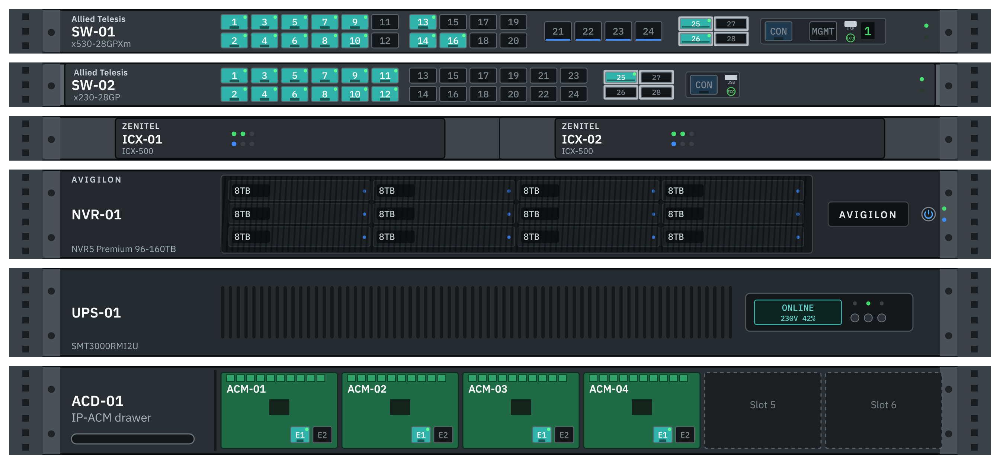

Every Allied Telesis and Zenitel model in the library:

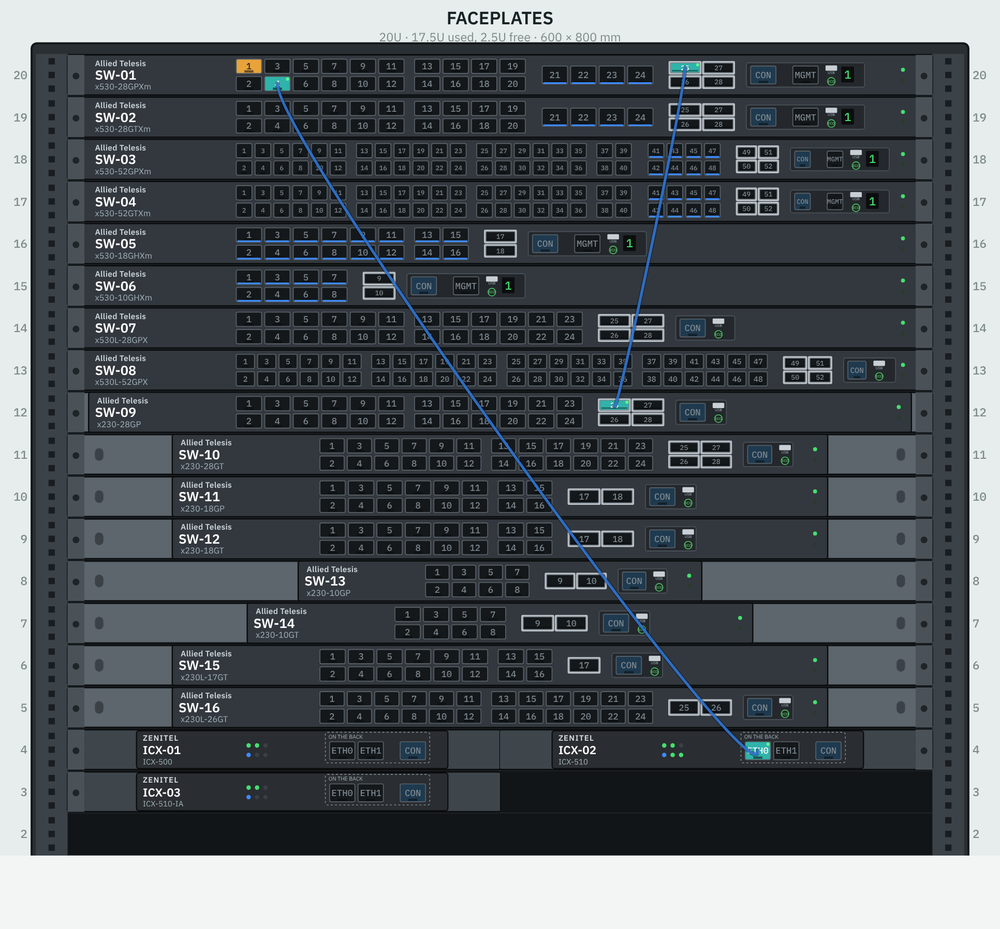

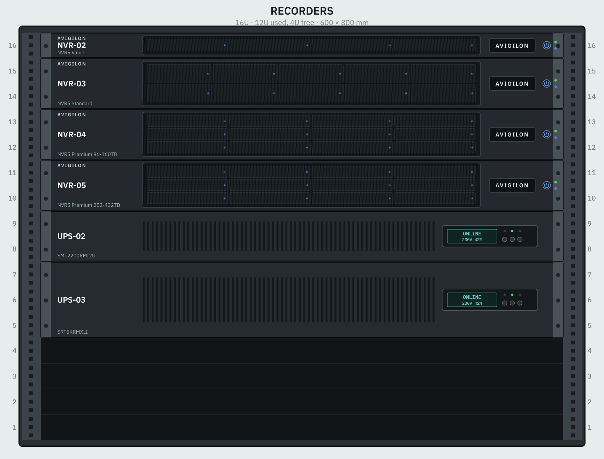

### Changing a model

Click a switch, ICX, recorder or UPS and pick another model from the **Model** box in its details. The faceplate redraws and the allocations move across to the ports with the same name and type. If any would be lost (for example going from a 52 port switch to a 28 port one) you're asked first. The details also hold the label, position, width, IP address, serial number, notes, power inlets and a grid of every port, coloured by status.

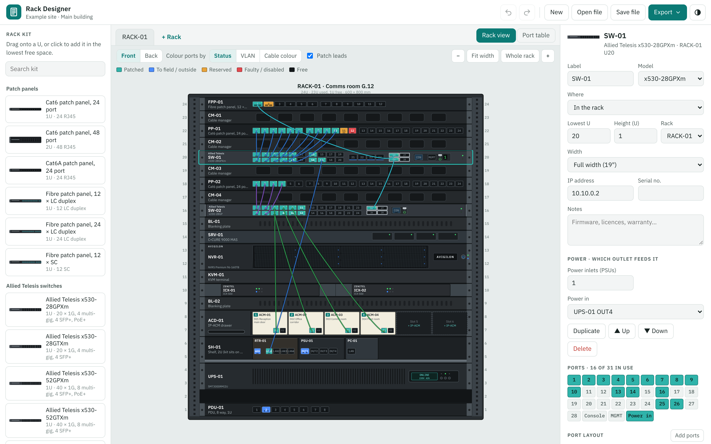

### All the kit

| Group | Kit |
| --- | --- |
| **Patch panels** | Cat6 24 port (1U), Cat6 48 port (2U), Cat6A 24 port, fibre 12 × LC duplex, fibre 24 × LC duplex, fibre 12 × SC |
| **Allied Telesis switches** | x530-28GPXm, x530-28GTXm, x530-52GPXm, x530-52GTXm, x530-18GHXm, x530-10GHXm, x530L-28GPX, x530L-52GPX, x230-28GP, x230-28GT, x230-18GP, x230-18GT, x230-10GP, x230-10GT, x230L-17GT, x230L-26GT |
| **Other switches and network** | Generic 24 + 4 SFP and 48 + 4 SFP switches; router / firewall; media converter chassis |
| **Zenitel** | ICX-500, ICX-510, ICX-510-IA (half width, two side by side on an IA-RS1 shelf) |
| **C•CURE / Software House** | IP-ACM pull-out drawer (2U, six boards), IP-ACM v2 door module |
| **Avigilon recorders** | NVR5 Value, NVR5 Standard, NVR5 Premium 96-160 TB, 192-224 TB and 252-432 TB |
| **Servers and recorders** | C•CURE 9000 server, NVR server 2U, NVR / recorder, 1U and 2U servers (with iDRAC), KVM terminal |
| **Power** | Rack UPS (SMT1500, SMT2200, SMT3000 2U and SRT 5 kVA 3U style), PDU 8 way 1U, vertical 0U PDU 16 way, vertical 0U PDU 20 × C13 + 4 × C19 |
| **Accessories and shelves** | Cable manager, brush plate, blanking plate, shelves (1U, 2U, 3U), fan tray |
| **Shelf kit** (sits on a shelf) | Desktop NVR with 8 PoE, desktop 8 port switch, router / modem, mini PC / workstation, power supply, media converter, small device |
| **Custom** | A custom device with whatever ports you give it |

Port types are RJ45, SFP, SFP+, LC duplex, SC, console, power outlet and power inlet. Ports are numbered the way the real kit is (switches zig-zag top/bottom, panels run left to right) and can have prefixes such as `NIC`, `LAN`, `OUT` or `CH`.

Search the library with the box at the top.

## Keyboard shortcuts

| Keys | Action |
| --- | --- |
| Ctrl+Z / Cmd+Z | Undo |
| Ctrl+Y, Ctrl+Shift+Z | Redo |
| Ctrl+S / Cmd+S | Save file |
| ↑ / ↓ | Move the selected device up or down 1U (a 0U PDU: swap with the other one on that side) |
| ← / → | With a port selected: previous / next port. With shelf kit or an IP-ACM selected: slide it along the shelf or to the next drawer slot |
| Delete / Backspace | Delete the selected device (Ctrl+Z brings it back) |
| Esc | Cancel picking, then clear the port, then the device selection |

## Building from source

The app is written as plain HTML, CSS and JavaScript in `src/`, with no framework and no npm packages. `build.py` puts it all into the single offline file, inlining jsPDF and the IBM Plex fonts from `vendor/`.

```sh
python3 -I build.py
# built dist/system-draw-rack-designer.html 646065 bytes
```

Python 3.8 or newer is all you need. GitHub Actions runs the build on every push to `main`, checks that the committed `dist/` file matches the source, and uploads the built page as a downloadable artifact.

To work on it, edit the files in `src/`, run the build and open `dist/system-draw-rack-designer.html` in a browser.

## Repository layout

```
.
├── build.py                       builds dist/ from src/ and vendor/
├── src/
│   ├── index.html                 page shell with build placeholders
│   ├── app.css                    styles, light and dark themes, laptop and phone layouts
│   └── app.js                     the app: kit catalogue, drawing, ports, table, exports
├── vendor/                        jsPDF and IBM Plex fonts (with their licences)
├── dist/
│   └── system-draw-rack-designer.html   the built app: this is the file to use
├── examples/                      exports made from the built-in example project
└── docs/screenshots/              the pictures in this README
```

## Third-party licences

- [jsPDF](https://github.com/parallax/jsPDF), MIT licence: [`vendor/LICENSE-jsPDF.txt`](vendor/LICENSE-jsPDF.txt)
- [IBM Plex](https://github.com/IBM/plex) fonts, SIL Open Font Licence 1.1: [`vendor/LICENSE-IBM-Plex-OFL.txt`](vendor/LICENSE-IBM-Plex-OFL.txt)

Rack Designer is part of the System Draw family of tools.
